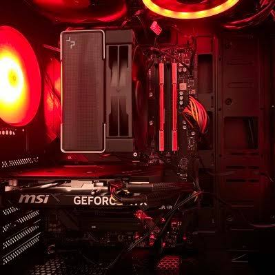

# warudora | Official Website

  

<strong>warudora（ワルドラ）の公式ポートフォリオサイト</strong>

Minecraft Modの開発、Web・ソフトウェア制作、コミュニティ運営など、warudoraの活動と制作実績を紹介しています。

**公式サイト：** https://warudora.github.io/

## 著作権・利用について

**本サイトはwarudoraが管理・公開する公式サイトです。**

サイトに掲載されたwarudora制作の文章・画像・写真・ロゴ・デザイン・ソースコードなどの著作権その他の権利は、warudoraに帰属します。第三者が制作した素材や、別途権利表示・ライセンスが付されたものの権利は、それぞれの権利者に帰属します。

**権利者の許諾なく、掲載物を転載・複製・改変・再配布したり、他のサイト・制作物・サービスに流用したりすることは認めません。** 特に、公式サイトや管理者を装う行為、公式の承認・提携があると誤認させる利用はお断りします。

GitHub上で閲覧できることは、掲載物を自由に利用できることを意味しません。個別のファイルやプロジェクトに明示されたライセンスがある場合は、その条件が優先します。法令で認められた引用などや、GitHubの利用規約に基づく操作は妨げません。

公式ページへの**通常のリンク共有は歓迎**します。掲載物の利用許諾が必要な場合は、事前に権利者へご相談ください。

## 関連サイト

- [MTR Japan Nexus（MJX）公式ルールブック・案内サイト](https://warudora.github.io/MJX-/) — MJXの名称・ロゴ・コンテンツは、MJX運営および各権利者の管理対象です。個人サイトとは別に扱います。

---

© 2026 warudora. All rights reserved.（権利が帰属する制作物について）
